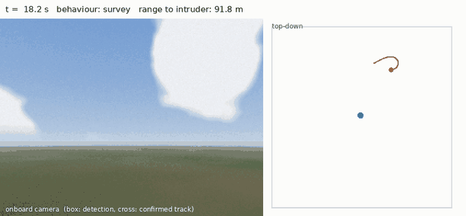
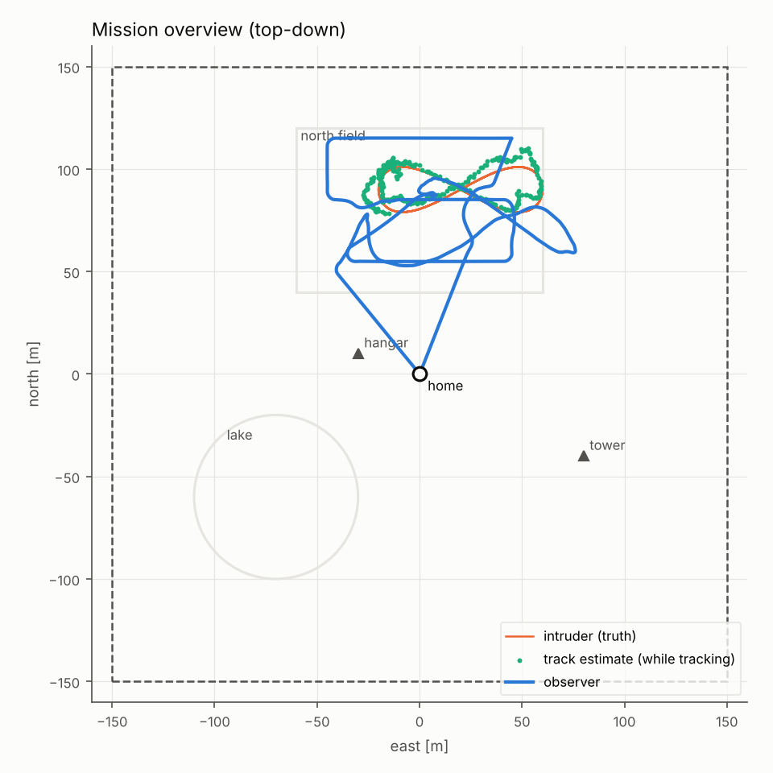
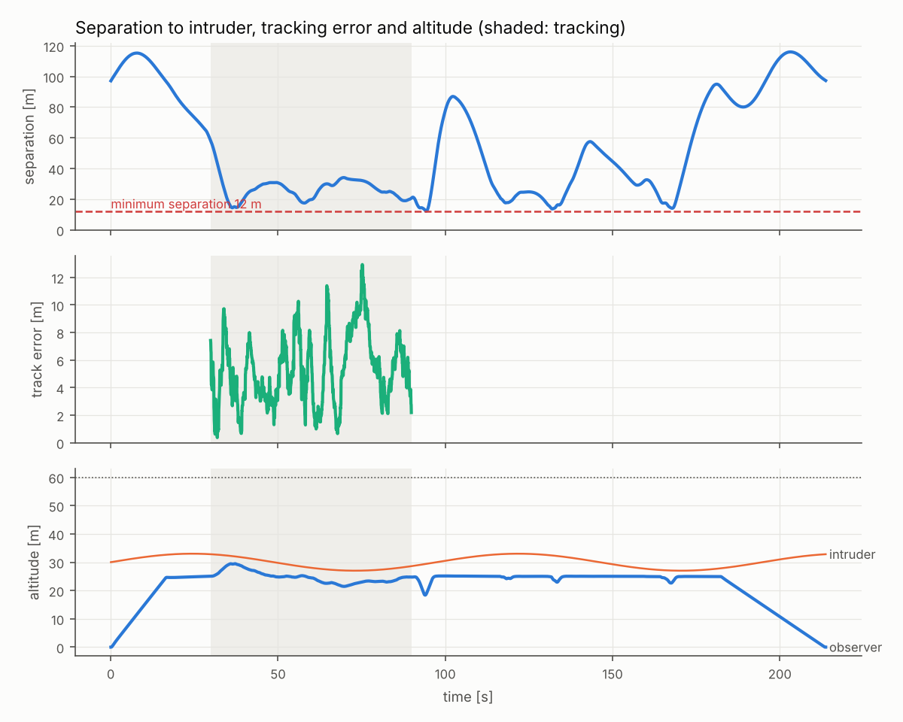
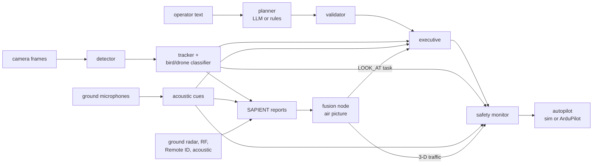

# Kestrel: an airborne sensor node you task in plain English

[](https://github.com/mustafarkhan/kestrel/actions/workflows/ci.yml)
[](LICENSE)


**Kestrel is an airborne sensor node for layered counter-drone defence and detect-and-avoid: it finds, tracks,
identifies and reports. It never engages.** It goes where fixed sensors are blind (low altitude, behind terrain,
temporary sites), confirms what ground sensors only half-see, and puts it into the shared air picture in
**SAPIENT**, the message standard NATO uses for counter-drone sensors. The role and its limits:
[docs/conops.md](docs/conops.md).

You task it in plain English: *"stand by at the berth for 30 minutes and investigate any acoustic cues, and if you
see a drone, follow it from 30 m"*. It turns that into a validated flight plan and flies it. When ground
microphones hear something, or the command node sends a SAPIENT `LOOK_AT` task, it goes and looks, finds the
aircraft **in camera pixels**, tells drones from birds, keeps clear, follows at a standoff, and reports. Two
observers fuse their cameras into one track and get range by triangulation. A jammed link does not stop it: it keeps
working on board for a bounded time and sends its reports when the link returns. A language model writes the plan;
it never touches the controls. Every setpoint passes an independent safety monitor.

Since v0.4 Kestrel also builds the **recognised air picture** it reports into: simulated radar, RF direction
finders, a Remote ID receiver and an acoustic grid each report over SAPIENT to a fusion node that removes
duplicates, tells drones from birds, identifies friend, neutral, suspect and unknown (never *hostile*: that is left
to an operator), and tasks Kestrel to go and look where the ground sensors cannot decide
([docs/air-picture.md](docs/air-picture.md)).

Since v0.6 the same code runs outside the simulator: SAPIENT in its binary wire format over TCP with mutual TLS, the
fusion node as a live service partners' sensors can connect to, a flight loop that takes camera frames, tasks and
traffic and stands down the moment a pilot takes over, pre-flight checks, a flight recorder, and output for TAK
displays. What that closes and what only hardware, flights and an authority can close is listed in
[docs/readiness.md](docs/readiness.md); the way from bench to first tasked flight is in
[docs/field-test-plan.md](docs/field-test-plan.md).



🎬 **[Project video (7 min 15 s)](docs/video/kestrel_demo.mp4)**: why small drones matter now, the instruction, the checked plan, a
rejected unsafe plan, a closed-loop flight with birds and acoustic cueing, bird-versus-drone on real rendered pixels,
SAPIENT output, the same code flying ArduCopter SITL, the measured results against a no-avoidance baseline, then the
sensor-node role: standing by over a harbour, investigating acoustic cues and a C2 tasking, working through a jammed
link, two observers triangulating one drone, the measured sensor-node results and the parts cost, then the air
picture: five kinds of sensor fused into one picture that identifies friend from spoofer and tasks Kestrel, and
its measured results, and what a visible and a thermal camera see at night.
Rendered only from the repository's own outputs by [`docs/video/make_video.py`](docs/video/make_video.py).

| | how | measured |
|---|---|---|
| **Plan from language** | local LLM (Ollama) constrained to a JSON Schema, re-validated, one repair round, deterministic fallback; stop/abort/land bypass the model | malformed, invented-site and garbage outputs all rejected in tests; same plan with or without a model |
| **Check before flight** | geofence, altitude band, speed, standoff vs. separation, battery energy with a traffic contingency | 7 of 216 benchmark runs used more than the estimate (worst 1.2×, two intruders giving way); none used more than 27 of the 62 Wh usable |
| **See other aircraft** | small-target sky detector on rendered frames: black top-hat, robust threshold, horizon mask, darker-than-sky test | 0.35 m drone: every frame to 45 m, about half at 60 m |
| **See at night** | long-wave thermal camera (320 × 256, 50°), white hot; the same detector on the inverted image ([0016](docs/decisions/0016-night-and-thermal.md)) | at night a visible camera tracked no drone in 24 encounters; thermal: 3/24 runs inside 12 m, with microphones 0/24 |
| **Tell birds from drones** | wing-beat flicker in the track's brightness, scored against sensor noise | held out: no drone called a bird; 73% of flapping birds rejected; gliding birds not ([0009](docs/decisions/0009-birds.md)) |
| **Hear what the camera cannot see** | ground microphone grid, 2° bearings, triangulated fixes that point the camera and widen the keep-out | see the results matrix |
| **Track** | bearing + log-range EKF per track, global-nearest-neighbour association, M-of-N confirmation | 4.6 m median position error while shadowing at ~30 m |
| **Keep clear** | give way to crossing traffic, standoff guidance, escape velocity; separation buffer from uncertainty, reachable set and stopping distance | risk ratio against no avoidance, below |
| **Report and take tasking** | SAPIENT BSI Flex 335 v2.0 registration, status and detection reports, UTM coordinates; accepts and acknowledges `LOOK_AT` tasks ([interop.md](docs/interop.md)) | encoded as protobuf from Dstl's schema and checked for the standard's mandatory fields in CI; framed TCP with mutual TLS 1.3; no run against a third-party fusion node yet |
| **Build the air picture** | radar, RF, Remote ID and acoustic nodes over SAPIENT; association, Kalman fusion with each report's errors, duplicate merging, bounded class evidence ([air-picture.md](docs/air-picture.md)) | each sensor alone against all fused on the same 24 situations: see the air-picture table |
| **Identify** | APP-6 identities: *friend* only for a whitelisted Remote ID serial corroborated by an independent sensor; a cloned serial is never a friend; *hostile* only by an operator | spoofed and cloned serials in the benchmark: see the air-picture table |
| **Investigate reports** | stand by on station; go and look when a ground sensor, an operator or the C2 node reports something; confirm, classify, follow | report to track: see the sensor-node table |
| **Work through jamming** | bounded on-board autonomy when the ground link is lost; reports held and sent with their original times | intruder held while jammed: see the sensor-node table |
| **Fly as a team** | two observers, one fused tracker, shared contacts, each other as cooperative traffic | intruder position error with two observers against one: see the sensor-node table |
| **Fly a real autopilot** | ArduPilot GUIDED over MAVLink (pymavlink); pre-flight checks, typed arming confirmation, pilot takeover, flight recorder | full mission flown on **ArduCopter 4.6.3 SITL in CI**; the flight loop tested on a bench vehicle with camera, fusion link and faults |
| **Run as a service** | `kestrel fusion`: the benchmarked fusion node behind a SAPIENT TCP server with mutual TLS; sensor health; operator declarations; Cursor on Target for ATAK/WinTAK; container and service unit | real sockets in the tests, compared against the direct result; hostile peers, bad clocks and off-site reports rejected |

> **Status (November 2026, v0.6).** Ready for integration testing, not fielded: technology readiness level 4.
> Everything here runs in simulation, on a bench and on ArduCopter SITL. It has **not flown on a real airframe**,
> has not been evaluated on real air-to-air footage or real sensor feeds, and nothing is flight-qualified or
> certified ([readiness.md](docs/readiness.md) lists every open item and who can close it). The camera, bird, aircraft and ground-sensor models are simplified. The known gaps are under [Limitations](#limitations), in
> [docs/safety.md](docs/safety.md) and, against published standards, in [docs/research.md](docs/research.md).
> Kestrel is a sensor: it detects, tracks, keeps clear and reports. It has no intercept, engagement or targeting
> function, and its reports describe airspace for its protection.

## Next: deployment and field testing

Simulation was the first gate, and v0.6 made the software ready to leave it. The next phase is deploying and
testing Kestrel with our own systems and our defence-technology partners, in the order of
[docs/field-test-plan.md](docs/field-test-plan.md):

- **Real sensor data.** The detector, tracker and bird/drone classifier evaluated on real air-to-air footage and
  real acoustic cues, and the fusion node run on recorded multi-sensor SAPIENT traffic (`kestrel fuse`), so the
  published numbers can be checked against the field.
- **Multi-sensor network fusion with real sensors.** The fusion node is built and measured in simulation (v0.4);
  the next step is Kestrel reporting alongside our partners' fixed sensors and taking `LOOK_AT` tasks from it.
- **Field trials.** The sensor-node mission flown on a real airframe against a cooperating target drone.

Results from that phase will be published here in the same way: measured, reproducible, with what did not work.

## Quick start

```bash
git clone https://github.com/mustafarkhan/kestrel && cd kestrel
pip install -e ".[dev]"

# parse + validate only (instant)
kestrel plan "take off, orbit the tower twice at 20 m with a radius of 30 m, then search the lake for 2 minutes, then come back"

# closed-loop simulation with report plots and the demo animation (a few minutes on a 2-core machine)
kestrel sim "Take off to 25 m, survey the north field at 25 m with 30 m spacing, and if you see a drone, \
follow it from 30 m for 60 seconds, then return home" --gif --out runs/demo

# everything on: birds in the sky, microphones, the bird/drone classifier, SAPIENT reports
kestrel sim "survey the north field at 25 m and follow any drone for 45 seconds" \
  --config configs/full.yaml --scenario scenarios/airfield_birds.yaml --sapient runs/sapient.jsonl

# the sensor-node posture over a harbour: stand by, investigate acoustic cues, follow what is confirmed
kestrel sim "take off to 25 m, stand by at the berth for 4 minutes and investigate any acoustic cues, \
and if you see a drone, follow it from 30 m for 45 seconds, then return home" \
  --config configs/full.yaml --scenario scenarios/port.yaml

# operator commands are injected by time: send it to look at a point at t = 90 s, abort at t = 200 s
kestrel sim "take off to 25 m and stand by at the hangar for 4 minutes" --command "90:investigate (40, 90)" --command "200:abort"

# operator emergencies are injected by time: abort at t = 60 s
kestrel sim "survey the north field at 25 m" --command "60:abort"

# at night: a visible camera sees nothing; a thermal camera, with ground microphones
kestrel sim "survey the north field at 25 m and follow any drone for 45 seconds" \
  --config configs/thermal_acoustic.yaml --scenario scenarios/airfield_night.yaml

# the detector on recorded footage with ground-truth boxes (Anti-UAV, YOLO or MOT layout)
kestrel evaluate path/to/anti-uav --format anti-uav --polarity bright --out runs/eval.json

# the air picture: ground sensors and Kestrel fused into one picture that tasks Kestrel
kestrel sim "take off to 25 m, stand by at the hangar for 4 minutes, then return home" \
  --config configs/birds.yaml --scenario scenarios/airfield_picture.yaml --picture --sapient runs/sapient.jsonl

# fuse any recorded SAPIENT log (JSON lines) into a picture, e.g. the one written above
kestrel fuse runs/sapient.jsonl --out runs/rap.jsonl --whitelist KST-FRIEND-0001

# the air-picture benchmarks: each sensor alone and all fused; then Kestrel listening, and tasked
kestrel picture --runs 24 --seed0 7000
kestrel picture --loop --runs 24 --seed0 8000
```

With a local language model (optional; without one the rule parser handles constrained English):

```bash
ollama pull qwen2.5:3b
kestrel plan "go have a look over the north field and keep an eye on any drone you spot" --llm
```

Against ArduCopter SITL (or a real ArduPilot vehicle):

```bash
# in an ArduPilot checkout: build/sitl/bin/arducopter --model quad --defaults Tools/autotest/default_params/copter.parm -I0
kestrel fly "take off to 15 m, fly to the tower, orbit the tower with a radius of 15 m, then return home" \
  --connect tcp:127.0.0.1:5760
```

Outside the simulator (`pip install "kestrel[live]"` adds OpenCV for the camera):

```bash
deploy/pki.sh pki fusion kestrel-1 radar-1           # a private CA for the site, one certificate per device

# the fusion node as a service: SAPIENT nodes connect over mutual TLS; the picture goes to a file and to ATAK
kestrel fusion --site sites/template.yaml --listen 0.0.0.0:5020 --out runs/rap.jsonl --cot 239.2.3.1:6969 \
  --tls-ca pki/ca.crt --tls-cert pki/fusion.crt --tls-key pki/fusion.key

# a recorded SAPIENT log streamed to it as if the sensors were there
kestrel send runs/sapient.jsonl --connect 127.0.0.1:5020 \
  --tls-ca pki/ca.crt --tls-cert pki/radar-1.crt --tls-key pki/radar-1.key

# the whole flight loop on a bench, no aircraft: simulated vehicle and camera behind the real loop
kestrel preflight "take off to 20 m, survey the north field at 25 m, then return home" \
  --connect bench --camera bench --scenario sites/template.yaml
kestrel fly "take off to 20 m, survey the north field at 25 m, then return home" \
  --connect bench --camera bench --scenario sites/template.yaml --sapient 127.0.0.1:5020 \
  --tls-ca pki/ca.crt --tls-cert pki/kestrel-1.crt --tls-key pki/kestrel-1.key
```

On an aircraft the same two commands take `--connect /dev/ttyAMA0` (or the telemetry address) and `--camera 0`
(or a GStreamer pipeline); arming needs the operator to type `FLY`. A track becomes *hostile* only when the
operator types `declare <track> HOSTILE` on the fusion console.

What the planner hands the rest of the stack:

```text
$ kestrel plan "survey the lake at 20 m with 6 m spacing then hover for 25 minutes"
planner: rules
plan: takeoff(altitude=20.0) -> survey(area=lake, altitude=20.0, spacing=6.0) -> hold(duration_s=1500.0) -> return_home()  [on_contact=report]
estimate: 27.6 min, 97.9 Wh nominal, 195.9 Wh with traffic contingency, of 61.6 Wh usable
warning: added takeoff at the start
warning: added return_home at the end
ERROR: estimated energy with traffic contingency 196 Wh exceeds the 62 Wh usable (20% reserve held back)
result: REJECTED
```

## Results

The same mission (survey, follow any drone for 45 s, return) is flown against the same 24 randomised encounters in
each configuration: intruder pattern (figure-eight, orbit, random waypoints), speed 2-6 m/s, altitude 26-40 m,
position, arrival time (late intruders fly in from 150 m out), wind 0-5 m/s with gusts, and a different sky each run.
These encounters (seeds 4000-4023) were never used while developing: sets from 1000 to 3999 were used for tuning
and for diagnosing the faults in the decision records.

Definitions follow detect-and-avoid practice, scaled to drone-to-drone encounters ([research.md](docs/research.md)):
**loss of well clear** is entering a 12 m sphere around another aircraft (Kestrel's own figure, since no standard
exists for drone-to-drone well clear); an **encounter is detected** if the intruder is correctly tracked for the 3 s
before it first comes within 30 m, after the Amazon Prime Air AOT benchmark; a **false alarm** is a track reported
as a drone that never corresponds to one.

| configuration | runs inside 12 m (entries) | closest approach | encounters detected 3 s before 30 m | false alarms per flight hour | missions completed (returned early for traffic) |
|---|---|---|---|---|---|
| no avoidance (baseline) | 18/24 (23) | 3.6 m | 18/24 | 0.0 | 24/24 (0) |
| one camera | 1/24 (1) | 7.7 m | 18/24 | 1.2 | 22/24 (2) |
| camera + acoustic cueing | 0/24 (0) | 12.1 m | 21/24 | 0.0 | 20/24 (4) |
| five-camera ring | 1/24 (1) | 12.0 m | 21/24 | 1.2 | 23/24 (1) |
| 4 birds, no classifier | 1/24 (2) | 8.9 m | 17/24 | 16.8 | 23/24 (1) |
| 4 birds + classifier | 1/24 (1) | 11.4 m | 18/24 | 4.8 | 24/24 (0) |
| two intruders | 15/24 (26) | 1.0 m | 11/24 | 5.6 | 22/24 (2) |
| two intruders, no avoidance | 20/24 (30) | 1.3 m | 16/24 | 2.1 | 24/24 (0) |
| two intruders, camera + acoustic | 4/24 (5) | 3.7 m | 15/24 | 2.3 | 12/24 (12) |
| two intruders, two observers | 18/24 (32) | 1.3 m | 21/24 | 5.6 | 24/24 (0) |
| night, one camera | 18/24 (23) | 3.6 m | 0/24 | 0.0 | 24/24 (0) |
| night, thermal camera | 3/24 (3) | 1.4 m | 16/24 | 0.0 | 23/24 (1) |
| night, thermal + acoustic | 0/24 (0) | 12.5 m | 20/24 | 0.0 | 20/24 (4) |
| thermal camera by day | 1/24 (2) | 3.1 m | 15/24 | 0.0 | 23/24 (1) |

| birds in the area | bird tracks | bird tracks reported as a drone | drone tracks reported as a drone |
|---|---|---|---|
| 4 birds, no classifier | 27 | 27 | 85/85 |
| 4 birds + classifier | 26 | 8 | 84/96 |

With one intruder, avoidance with one camera has a **risk ratio of 0.06**: 1 of 24 runs lost well clear, against 18 of 24 flying the same encounters without avoidance. Each added layer is measured on the same encounters. With two intruders the ratio is 0.75 (15 against 20 of 24), because one forward camera cannot watch two aircraft; the acoustic network brings it to 4 of 24, at the cost of 12 missions ending early for traffic ([0013](docs/decisions/0013-two-intruders.md)). Two observers against two intruders made it worse, not better: 18 of 24 runs had an observer inside 12 m (32 entries, about 16 per observer against 26 for one). A second aircraft in the same airspace is a second aircraft to keep apart, and cross-cueing, which turns the second camera to the drone the first is following, probably also turns it away from the other drone; that has not yet been traced run by run, and it is the next thing to fix. With birds in the area, the classifier cuts false alarms from 16.8 to 4.8 per flight hour. 8 of 26 bird tracks were still reported as drones (a gliding bird shows no wing-beat; [0009](docs/decisions/0009-birds.md)). 12 of 96 drone tracks were never reported as drones, being too faint or brief to classify; the safety monitor kept clear of them all the same.

**At night** a visible camera is no sensor: it tracked no drone in 24 encounters, and the runs are identical to flying without avoidance (18 of 24 inside 12 m). A thermal camera restores most of the daytime protection (3 of 24), with no false alarms on warm clouds; its narrower 50° view is the cost: in two of the three runs that came close, the drone stayed outside it until too late. With the ground microphones as well, no run went inside 12 m at night (closest 12.5 m), at the same cost as by day: 4 missions ended early to give way to traffic ([0016](docs/decisions/0016-night-and-thermal.md)).

### The sensor node

The standby mission: wait on station near the hangar, investigate reports, follow a confirmed drone for 45 s, return
after 4 minutes. 24 further encounters (seeds 6000-6023, never used while developing), same intruder generator.
"Report to track" runs from the first ground-sensor report reaching the observer (while it is still on the ground,
so launch is included) to the first camera track on the intruder; "geofence entry to track" from the intruder
crossing the fence. Position error is over every moment an intruder was tracked, not only while following.

| sensor node | report to track (median / p90) | geofence entry to track (median / p90) | runs with a drone confirmed | intruder position error (median) | runs inside 12 m | missions completed | intruder held while jammed | reports sent late |
|---|---|---|---|---|---|---|---|---|
| camera only | n/a | 49 s / 145 s | 17/24 | 4.9 m | 3/24 | 24/24 | n/a | 0 |
| camera + acoustic cueing | 23 s / 26 s | 20 s / 26 s | 24/24 | 4.8 m | 1/24 | 24/24 | n/a | 0 |
| two observers + acoustic | 24 s / 39 s | 20 s / 39 s | 23/24 | 1.4 m | 3/24 | 24/24 | n/a | 0 |
| link jammed 60 s, return home | 22 s / 26 s | 20 s / 24 s | 22/24 | 5.1 m | 0/24 | 0/24 | 267 of 1254 s | 194 |
| link jammed 60 s, keep working | 23 s / 26 s | 20 s / 26 s | 24/24 | 4.4 m | 2/24 | 24/24 | 1304 of 1440 s | 4124 |

Ground sensors are what make the node fast. With the camera alone, waiting on station, a drone was tracked in 17 of 24 runs, a median 49 s after it crossed the fence (90th percentile 145 s). With microphones cueing it, in 24 of 24, 20 s after entry (90th percentile 26 s) and 23 s after the first report, launch included. A second observer cut the intruder position error from 4.8 m to 1.4 m (median), because two lines of sight fix range where one camera has to guess it from the drone's assumed size; the cost is a second aircraft that can come close to the intruder (3 runs inside 12 m against 1). Under a 60 s jam, the civil policy (return home after 5 s of link loss) ended every mission and held the intruder for 267 of the 1254 jammed seconds it was still airborne; keeping working held it for 1304 of 1440 s, completed 24 of 24 missions and sent 4124 reports late with their original timestamps, at the cost of 2 runs inside 12 m against 0.

Reproduce any row with the command in [docs/results/matrix.json](docs/results/matrix.json); per-run rows are in
`docs/results/<set>/results.csv`. A test fails CI if these tables and the committed results disagree.

### The air picture

24 situations over a 1.6 km area around an airfield (seeds 7000-7023, never used while developing), 10 minutes
each: six drones (three hostile: one with a radio link, one radio-silent with an engine, one radio-silent and quiet;
two friendly with whitelisted Remote ID serials; one civil) and twelve birds, against a radar, four RF direction
finders, a Remote ID receiver and an acoustic grid. In 10 of the 24 a seventh drone, a spoofer, broadcasts a
friend's serial from a false position. The same situations are scored with each sensor alone and with all of them
fused ([air-picture.md](docs/air-picture.md)).

| sensors | hostile drone-time covered | drone-time shown as UAV | bird-time shown as UAV | friend-time shown as friend | hostile shown as friend / phantom friend (total) | duplicate track ratio | track ids per drone | GOSPA |
|---|---|---|---|---|---|---|---|---|
| radar alone | 78% | 72% | 0% | 0% | 0 s / 0 s | 0.000 | 1.38 | 31.8 m |
| RF direction finders alone | 34% | 100% | 0% | 0% | 0 s / 0 s | 0.000 | 1.43 | 66.7 m |
| acoustic grid alone | 62% | 100% | 0% | 0% | 0 s / 0 s | 0.000 | 1.71 | 57.0 m |
| Remote ID alone | 0% | 100% | 0% | 0% | 0 s / 10 s | 0.000 | 1.01 | 59.3 m |
| all fused, no whitelist | 78% | 96% | 2% | 0% | 0 s / 0 s | 0.001 | 1.50 | 32.5 m |
| all fused | 78% | 96% | 2% | 82% | 2 s / 16 s | 0.001 | 1.50 | 32.5 m |

Fusion is about knowing what a track is, more than about seeing more. The radar finds as many hostile drones as
everything together (78% of the hostile drone-time), but on its own it calls only 72% of drone-time *UAV* and
leaves the rest unknown, because a micro-Doppler score is a weak opinion. Fused, 96% of drone-time is shown as *UAV*
and 2% of bird-time as *UAV*; the RF, acoustic and Remote ID nodes hear only drones, so they settle the class
wherever they reach. The fourth of hostile drone-time no sensor covers is low, radio-silent and quiet drones
beyond the radar's clutter horizon: fusion cannot report what no sensor saw, which is where an airborne node is
sent. Friendly drones are shown as *friend* 82% of the time (never without an independent sensor in the right
place). Remote ID alone shows a spoofer's broadcast as a friend where no friend is (10 s); fused, the clone rule
keeps every copy of a cloned serial from being a friend, and the 16 s of phantom friend left come from two spoofer
runs in which the false position lay within 50 m of the real friend, inside the radar's gate. The 2 s of a hostile
shown as friend are close crossings, where the friendly track passed within 2 m of a hostile and the scoring
matched the hostile to it.

Then Kestrel flies with the picture: standing by at the hangar for 4 minutes while a radio-silent, quiet drone
the radar sees but cannot classify comes in, alongside a friendly drone and the birds (seeds 8000-8023). Either
the picture only listens to Kestrel's reports, or it tasks Kestrel to go and look.

| with Kestrel | hostile drones classified as UAV | first track to UAV (median / p90) | drone-time shown as UAV | drone-time shown as bird | looks flown per mission | missions completed | runs inside 12 m | closest approach |
|---|---|---|---|---|---|---|---|---|
| picture without tasking | 20/24 | 7 s / 80 s | 83% | 0% | 0.0 | 24/24 | 0/24 | 44.6 m |
| picture tasks Kestrel | 23/24 | 16 s / 46 s | 92% | 0% | 7.2 | 24/24 | 0/24 | 12.4 m |

Tasking classified the hostile drone in 23 of 24 encounters against 20, and cut the 90th percentile from first
track to *UAV* from 80 s to 46 s. The median rose from 7 to 16 s only because tasking adds the hard cases: on the
19 encounters classified both ways, tasking was faster in 7 and never slower. Untasked, Kestrel classified one
encounter (236 s after the first track) that tasked it did not. The cost is proximity: sent to look, Kestrel came
to 12.4 m of a drone at closest, against 44.6 m standing by, and no run went inside 12 m. That only holds since the
picture's 3-D tracks reach Kestrel's separation filter: before, one tasked look flew under the hostile drone, held
by the radar 10 m above Kestrel and out of its camera's view ([0015](docs/decisions/0015-air-picture.md)).





## How it works



Three independent barriers stand between language and motors: the **schema** (the model can only express known
tasks), **static validation** (the plan must fit the fence, altitude band, battery and separation rules before
takeoff) and a **runtime monitor** (every setpoint, every tick). Details in [docs/architecture.md](docs/architecture.md)
and [docs/safety.md](docs/safety.md).

The separation buffer around another aircraft is the minimum separation plus the larger of the track uncertainty
(floored at 15% of range, because monocular range rests on an assumed target size) and a reachable set that grows
while the aircraft is unseen, plus stopping distance at the current closing speed. It applies to every contact: a
bird is a collision hazard too, and a drone mistaken for a bird must not lose protection. The classifier changes what
is reported and followed, never what is avoided.

## Engineering notes

Problems found in simulation and fixed, with before/after measurements, are written up as decision records:

| | problem | fix |
|---|---|---|
| [0001](docs/decisions/0001-llm-plans-never-pilots.md) | language control is slow, non-deterministic, sometimes wrong | the model writes a schema-checked plan only |
| [0002](docs/decisions/0002-darker-than-sky.md) | gaps between clouds keep a constant bearing and were tracked as an aircraft pacing the observer | darker-than-clear-sky test: 98.6% of clutter rejected |
| [0003](docs/decisions/0003-stabilised-gimbal.md) | rigid camera pointed at the ground whenever the airframe tilted | stabilised gimbal with commanded tilt |
| [0004](docs/decisions/0004-separation.md) | separation violations, one cause at a time | range floor, stopping distance, reachable set, contact watch, giving way |
| [0005](docs/decisions/0005-attitude-limit-cycle.md) | 180° heading reversal triggered a roll/pitch limit cycle and a fall | yaw slew limit, attitude-priority mixer: 47.6° → 3.6° tilt |
| [0006](docs/decisions/0006-cascaded-position-loop.md) | 13.8 m/s against an 8 m/s limit | cascaded, speed-saturated position loop |
| [0007](docs/decisions/0007-speed-planning.md) | 15 m orbit took 90 s on SITL | curvature-aware speed profile: 22 s |
| [0008](docs/decisions/0008-mavlink-adapter.md) | SITL armed and disarmed in a loop | heartbeat-derived ids, single reader, origin on the ground |
| [0009](docs/decisions/0009-birds.md) | no birds in the sky, so false alarms were understated | birds with intermittent flight; wing-beat flicker classifier |
| [0010](docs/decisions/0010-area-true-rendering.md) | sub-pixel parts drawn too large: drones detectable too far out | area-true drawing; every benchmark re-run |
| [0011](docs/decisions/0011-cues-identity-and-the-way-home.md) | giving way to cued aircraft already tracked; one drone followed three times; stuck on the way home | cues explained by a track dropped; aircraft identity across tracks; homeward yield cap |
| [0012](docs/decisions/0012-contact-watch-memory.md) | camera kept staring at where an intruder had been a minute earlier while traffic came head-on | watch a stale contact for 15 s, then look where you are going: 3/24 → 1/24 runs inside 12 m |
| [0013](docs/decisions/0013-two-intruders.md) | two intruders: one camera loses well clear in 15/24 runs, mostly to the aircraft it is not looking at | measured, explained; acoustic cueing cuts it to 4/24 at the cost of early returns |
| [0014](docs/decisions/0014-sensor-node.md) | investigating from a climbing altitude put targets below the horizon; standby never ended under repeated cues; teammates tracked as intruders; two observers following one drone | hold mission altitude; standby time includes excursions; friendly by bearing, safety on all tracks; contacts claimed within the tick |
| [0015](docs/decisions/0015-air-picture.md) | class evidence summed over every report made birds certain; a spoofer inherited a friend's corroboration; tasked looks queued stale positions and left too early; a tasked look flew under a drone only the radar held | bounded per-sensor evidence; corroboration by an independent sensor and the clone rule; a look follows the track until it is resolved; the picture's 3-D tracks go to the separation filter |
| [0016](docs/decisions/0016-night-and-thermal.md) | every benchmark was flown by day; at night a visible camera sees nothing | thermal palette and a bright-target detector: 18/24 → 3/24 runs inside 12 m at night, 0/24 with microphones |

## Testing

| job | what | runs |
|---|---|---|
| `lint` | ruff, ruff format, mypy `--strict` | every push |
| `unit` | 179 tests incl. malformed sensor reports and operator files refused, the SAPIENT wire format (framing fuzzed, mandatory fields, mutual TLS), the fusion service over real sockets, the flight loop on a bench vehicle with faults injected (pilot takeover, silent autopilot, dead camera), pre-flight checks from the command line, property-based safety invariants (Hypothesis), rendered-frame perception and bird/drone checks, night and thermal detection, the real-data evaluation harness in three layouts, SAPIENT messages parsed against the published v2.0 schema, UTM against PROJ, sensor blind spots, fusion consistency, friend/spoof/clone identification, LLM planner against a local HTTP server, README tables against the committed results | Python 3.11, 3.12, 3.13 |
| `closed-loop` | full-stack simulations: detect, track and keep separation; operator abort; link-loss failsafe; rejected plans never fly | every push |
| `sitl` | builds ArduCopter 4.6.3 SITL (cached) and flies a mission through GUIDED mode | every push |
| `package` | builds the wheel, installs it in a clean environment and uses it; builds and runs the container | every push |
| `audit` | dependency vulnerability audit | weekly |

```bash
pytest -m "not slow and not sitl"   # about a minute
pytest -m slow                      # a few minutes
ARDUPILOT_SITL=.../arducopter ARDUPILOT_DEFAULTS=.../copter.parm pytest -m sitl
```

## Limitations

- **Simulation, bench and SITL, not flight.** No real airframe, no results on real footage, no real sensor connected,
  no certification of any kind. [docs/readiness.md](docs/readiness.md) is the full register: what v0.6 closed, each
  with the test that guards it, and what stays open until hardware, flights, data or an authority close it.
- **Two observers** share a perfect datalink in simulation; its loss, latency and bandwidth are not modelled. A
  second observer doubles the number of aircraft that can come close to an intruder, and the table shows it.
- **Jammed-link autonomy** is bounded (2 minutes by default) and covers the ground link only: navigation still
  relies on GNSS, and visual navigation is roadmap.
- **One forward camera by default.** An aircraft that never enters its field of view cannot be seen. The acoustic
  network and a five-camera ring are measured above as mitigations, not assumed.
- **Synthetic sky.** Detection works on rendered pixels, so misses and false alarms are emergent, but the sky,
  optics and targets are simplified. Sunlit targets brighter than the sky and targets below the horizon are out of
  scope for the detector. The thermal image is a palette, not a radiometric model: no atmospheric attenuation, no
  fixed-pattern noise, no thermal crossover at dawn and dusk. `kestrel evaluate` runs the detector on real footage
  ([docs/real-data.md](docs/real-data.md)); no real-footage results are published yet.
- **Birds** are medium-sized and fly intermittently; gliding birds are reported as drones, because the cue the
  classifier uses (the wing-beat) is absent.
- **Acoustic model** has bearing noise, range and latency, but no wind, terrain or urban noise.
- **Monocular range** rests on an assumed target size (0.35 m). The safety monitor's 15% range-uncertainty floor
  covers modest errors, not a wrong aircraft class.
- **SAPIENT** is encoded and framed as the standard specifies and checked against Dstl's published schema, but has
  not been run against the SAPIENT test harness or a third-party fusion node; `follow`, `move_to` and `patrol`
  tasks are not accepted ([interop.md](docs/interop.md)).
- **Links.** The SAPIENT link is mutually authenticated and encrypted; the MAVLink link to the autopilot is not
  signed by Kestrel (configure MAVLink 2 signing on the autopilot and radios), and navigation relies on GNSS.
- **Ground sensors** in the air picture are simple models with typical published parameters, not particular
  products: radar is the radar equation with clutter masking by a range-and-height rule, micro-Doppler is a noisy
  score, not a spectrum ([air-picture.md](docs/air-picture.md#limits)).
- **Remote ID is not authenticated.** A hostile broadcasting one of our serials from its own true position while our
  drone with that serial is on the ground would be corroborated and shown as friend. A fielded system needs
  authenticated friendly-force tracking.
- **ArduPilot only.** PX4 OFFBOARD is detected and refused rather than half-supported.

## Repository layout

```text
src/kestrel/
  mission/      schema, rule parser, LLM planner, validator, task geometry, executive
  perception/   camera + gimbal, sky renderer (visible and thermal, day and night), detector, tracker, bird/drone
                classifier, acoustic network, evaluation on recorded footage
  guidance/     paths, speed planning, reference filter, standoff observation
  safety/       runtime monitor, energy model
  control/      cascaded position + SE(3) attitude control, mixer
  sim/          rigid-body quadrotor, wind, intruders, birds, world
  vehicle/      Vehicle protocol, simulated vehicle, ArduPilot over MAVLink, bench vehicle behind the real loop
  interop/      SAPIENT messages and tasking, protobuf wire format and TLS transport, Cursor on Target, UTM
  rap/          the air picture: ground sensor models, fusion node and live service, scoring, tasking, replay
  runtime.py    closed-loop simulation      team.py   several observers, one fused picture
  live.py       real-time flight loop       preflight.py   checks before arming
  bench.py      Monte Carlo benchmark       cli.py    kestrel plan | sim | bench | picture | fuse | fusion | send |
                                                      evaluate | preflight | fly
deploy/         private CA script, systemd unit        sites/    site file template        Dockerfile
docs/           concept of operations, architecture, safety case, readiness register, field test plan, research
                and standards map, SAPIENT mapping, decision records, published results, video and its renderer
scripts/        SITL flight recording; benchmark result collection
configs/        default, acoustic, acoustic with the jam-resilient link policy, camera ring, birds, thermal, thermal +
                acoustic, everything on
scenarios/      airfield, airfield by night, airfield with birds, harbour (sea surface), airfield with ground sensors
                (air picture)
third_party/    Dstl's SAPIENT protobuf schema (Apache-2.0), for the conformance test
tests/          unit, property, closed-loop and SITL tests
```

## Contributing

Kestrel is open so that it can be tested, criticised and built on. [CONTRIBUTING.md](CONTRIBUTING.md) says what is
in scope (and that intercept, engagement and targeting never are) and what a pull request must pass. Results from
real footage, sensors or flights are the most valuable contribution, whether they confirm the simulation or not.
Vulnerabilities go through [SECURITY.md](SECURITY.md), not public issues.

## License

Apache-2.0. See [LICENSE](LICENSE). If you use this work, see [CITATION.cff](CITATION.cff).
