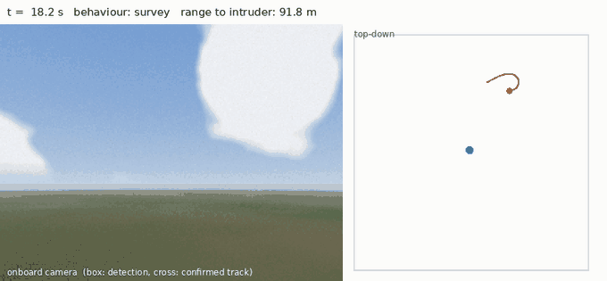
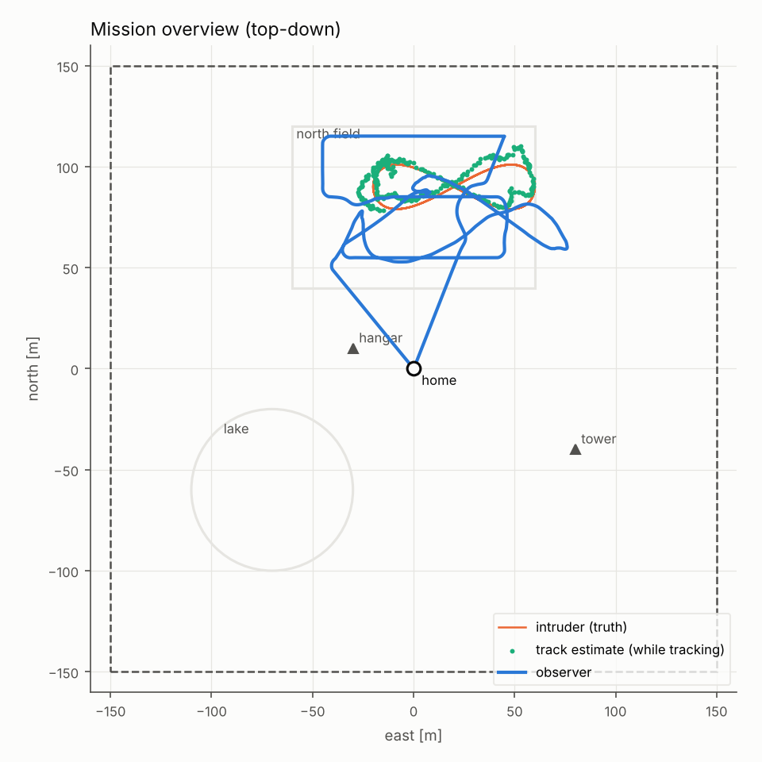
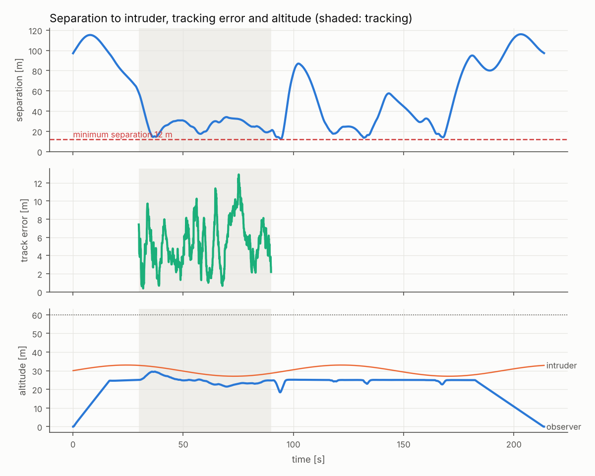
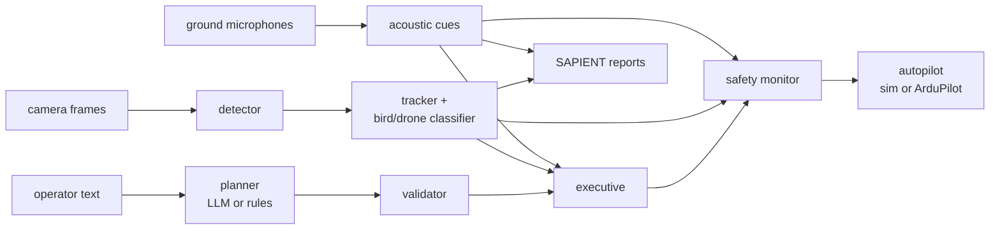

# Kestrel: a language-tasked aerial observer

[](https://github.com/mustafarkhan/kestrel/actions/workflows/ci.yml)
[](LICENSE)


Tell a small drone, in plain English, to *"survey the north field at 25 m and if you see a drone, follow it from
30 m for 60 seconds, then come home"*. Kestrel turns that into a validated flight plan and flies it. It finds other
aircraft **in camera pixels**, tells drones from birds, takes cues from a ground microphone network, keeps clear,
shadows the intruder at a safe standoff, reports everything in **SAPIENT**, the message standard NATO uses for
counter-drone sensors, then resumes the survey and lands. A language model writes the plan; it never touches the
controls. Every setpoint passes an independent safety monitor that no planner, learned or not, can get past.



🎬 **[Project video](docs/video/kestrel_demo.mp4)**: why small drones matter now, the instruction, the checked plan, a
rejected unsafe plan, a closed-loop flight with birds and acoustic cueing, bird-versus-drone on real rendered pixels,
SAPIENT output, the same code flying ArduCopter SITL, and the measured results against a no-avoidance baseline.
Rendered only from the repository's own outputs by [`docs/video/make_video.py`](docs/video/make_video.py).

| | how | measured |
|---|---|---|
| **Plan from language** | local LLM (Ollama) constrained to a JSON Schema, re-validated, one repair round, deterministic fallback; stop/abort/land bypass the model | malformed, invented-site and garbage outputs all rejected in tests; same plan with or without a model |
| **Check before flight** | geofence, altitude band, speed, standoff vs. separation, battery energy with a traffic contingency | no benchmark mission exceeded its energy estimate |
| **See other aircraft** | small-target sky detector on rendered frames: black top-hat, robust threshold, horizon mask, darker-than-sky test | 0.35 m drone: every frame to 45 m, about half at 60 m |
| **Tell birds from drones** | wing-beat flicker in the track's brightness, scored against sensor noise | held out: no drone called a bird; 73% of flapping birds rejected; gliding birds not ([0009](docs/decisions/0009-birds.md)) |
| **Hear what the camera cannot see** | ground microphone grid, 2° bearings, triangulated fixes that point the camera and widen the keep-out | see the results matrix |
| **Track** | bearing + log-range EKF per track, global-nearest-neighbour association, M-of-N confirmation | 4.6 m median position error while shadowing at ~30 m |
| **Keep clear** | give way to crossing traffic, standoff guidance, escape velocity; separation buffer from uncertainty, reachable set and stopping distance | risk ratio against no avoidance, below |
| **Report** | SAPIENT ICD v7 registration, status and detection reports, UTM coordinates ([interop.md](docs/interop.md)) | mandatory fields and coordinates tested; no conformance run yet |
| **Fly a real autopilot** | ArduPilot GUIDED over MAVLink (pymavlink) | full mission flown on **ArduCopter 4.6.3 SITL in CI** |

> **Status (October 2026, v0.2).** Everything here runs in simulation and on ArduCopter SITL. It has **not flown on
> a real airframe**, has not been evaluated on real air-to-air footage, and nothing is flight-qualified. The camera,
> bird and aircraft models are simplified. The known gaps are under [Limitations](#limitations), in
> [docs/safety.md](docs/safety.md) and, against published standards, in [docs/research.md](docs/research.md).
> Kestrel is an observer: it detects, tracks, keeps clear and reports. It has no intercept or engagement function.

## Quick start

```bash
git clone https://github.com/mustafarkhan/kestrel && cd kestrel
pip install -e ".[dev]"

# parse + validate only (instant)
kestrel plan "take off, orbit the tower twice at 20 m with a radius of 30 m, then search the lake for 2 minutes, then come back"

# closed-loop simulation with report plots and the demo animation (a few minutes on a 2-core machine)
kestrel sim "Take off to 25 m, survey the north field at 25 m with 30 m spacing, and if you see a drone, \
follow it from 30 m for 60 seconds, then return home" --gif --out runs/demo

# everything on: birds in the sky, microphones, the bird/drone classifier, SAPIENT reports
kestrel sim "survey the north field at 25 m and follow any drone for 45 seconds" \
  --config configs/full.yaml --scenario scenarios/airfield_birds.yaml --sapient runs/sapient.jsonl

# operator emergencies are injected by time: abort at t = 60 s
kestrel sim "survey the north field at 25 m" --command "60:abort"
```

With a local language model (optional; without one the rule parser handles constrained English):

```bash
ollama pull qwen2.5:3b
kestrel plan "go have a look over the north field and keep an eye on any drone you spot" --llm
```

Against ArduCopter SITL (or a real ArduPilot vehicle):

```bash
# in an ArduPilot checkout: build/sitl/bin/arducopter --model quad --defaults Tools/autotest/default_params/copter.parm -I0
kestrel fly "take off to 15 m, fly to the tower, orbit the tower with a radius of 15 m, then return home" \
  --connect tcp:127.0.0.1:5760
```

What the planner hands the rest of the stack:

```text
$ kestrel plan "survey the lake at 20 m with 6 m spacing then hover for 25 minutes"
planner: rules
plan: takeoff(altitude=20.0) -> survey(area=lake, altitude=20.0, spacing=6.0) -> hold(duration_s=1500.0) -> return_home()  [on_contact=report]
estimate: 27.6 min, 97.9 Wh nominal, 195.9 Wh with traffic contingency, of 61.6 Wh usable
warning: added takeoff at the start
warning: added return_home at the end
ERROR: estimated energy with traffic contingency 196 Wh exceeds the 62 Wh usable (20% reserve held back)
result: REJECTED
```

## Results

The same mission (survey, follow any drone for 45 s, return) is flown against the same 24 randomised encounters in
each configuration: intruder pattern (figure-eight, orbit, random waypoints), speed 2-6 m/s, altitude 26-40 m,
position, arrival time (late intruders fly in from 150 m out), wind 0-5 m/s with gusts, and a different sky each run.
These encounters (seeds 4000-4023) were never used while developing: sets from 1000 to 3999 were used for tuning
and for diagnosing the faults in the decision records.

Definitions follow detect-and-avoid practice, scaled to drone-to-drone encounters ([research.md](docs/research.md)):
**loss of well clear** is entering a 12 m sphere around another aircraft (Kestrel's own figure, since no standard
exists for drone-to-drone well clear); an **encounter is detected** if the intruder is correctly tracked for the 3 s
before it first comes within 30 m, after the Amazon Prime Air AOT benchmark; a **false alarm** is a track reported
as a drone that never corresponds to one.

RESULTS_TABLE

BIRDS_TABLE

RISK_SENTENCE

Reproduce any row with the command in [docs/results/matrix.json](docs/results/matrix.json); per-run rows are in
`docs/results/<set>/results.csv`. A test fails CI if these tables and the committed results disagree.





## How it works



Three independent barriers stand between language and motors: the **schema** (the model can only express known
tasks), **static validation** (the plan must fit the fence, altitude band, battery and separation rules before
takeoff) and a **runtime monitor** (every setpoint, every tick). Details in [docs/architecture.md](docs/architecture.md)
and [docs/safety.md](docs/safety.md).

The separation buffer around another aircraft is the minimum separation plus the larger of the track uncertainty
(floored at 15% of range, because monocular range rests on an assumed target size) and a reachable set that grows
while the aircraft is unseen, plus stopping distance at the current closing speed. It applies to every contact: a
bird is a collision hazard too, and a drone mistaken for a bird must not lose protection. The classifier changes what
is reported and followed, never what is avoided.

## Engineering notes

Problems found in simulation and fixed, with before/after measurements, are written up as decision records:

| | problem | fix |
|---|---|---|
| [0001](docs/decisions/0001-llm-plans-never-pilots.md) | language control is slow, non-deterministic, sometimes wrong | the model writes a schema-checked plan only |
| [0002](docs/decisions/0002-darker-than-sky.md) | gaps between clouds keep a constant bearing and were tracked as an aircraft pacing the observer | darker-than-clear-sky test: 98.6% of clutter rejected |
| [0003](docs/decisions/0003-stabilised-gimbal.md) | rigid camera pointed at the ground whenever the airframe tilted | stabilised gimbal with commanded tilt |
| [0004](docs/decisions/0004-separation.md) | separation violations, one cause at a time | range floor, stopping distance, reachable set, contact watch, giving way |
| [0005](docs/decisions/0005-attitude-limit-cycle.md) | 180° heading reversal triggered a roll/pitch limit cycle and a fall | yaw slew limit, attitude-priority mixer: 47.6° → 3.6° tilt |
| [0006](docs/decisions/0006-cascaded-position-loop.md) | 13.8 m/s against an 8 m/s limit | cascaded, speed-saturated position loop |
| [0007](docs/decisions/0007-speed-planning.md) | 15 m orbit took 90 s on SITL | curvature-aware speed profile: 22 s |
| [0008](docs/decisions/0008-mavlink-adapter.md) | SITL armed and disarmed in a loop | heartbeat-derived ids, single reader, origin on the ground |
| [0009](docs/decisions/0009-birds.md) | no birds in the sky, so false alarms were understated | birds with intermittent flight; wing-beat flicker classifier |
| [0010](docs/decisions/0010-area-true-rendering.md) | sub-pixel parts drawn too large: drones detectable too far out | area-true drawing; every benchmark re-run |
| [0011](docs/decisions/0011-cues-identity-and-the-way-home.md) | giving way to cued aircraft already tracked; one drone followed three times; stuck on the way home | cues explained by a track dropped; aircraft identity across tracks; homeward yield cap |

## Testing

| job | what | runs |
|---|---|---|
| `lint` | ruff, ruff format, mypy `--strict` | every push |
| `unit` | TEST_COUNT tests incl. property-based safety invariants (Hypothesis), rendered-frame perception and bird/drone checks, SAPIENT message fields and UTM against PROJ, LLM planner against a local HTTP server | Python 3.11, 3.12, 3.13 |
| `closed-loop` | full-stack simulations: detect, track and keep separation; operator abort; link-loss failsafe; rejected plans never fly | every push |
| `sitl` | builds ArduCopter 4.6.3 SITL (cached) and flies a mission through GUIDED mode | every push |

```bash
pytest -m "not slow and not sitl"   # about a minute
pytest -m slow                      # a few minutes
ARDUPILOT_SITL=.../arducopter ARDUPILOT_DEFAULTS=.../copter.parm pytest -m sitl
```

## Limitations

- **Simulation, not flight.** No real airframe, no real footage. The first roadmap item is evaluating the detector
  on public real air-to-air data; after that, flights with a cooperating target drone.
- **One forward camera by default.** An aircraft that never enters its field of view cannot be seen. The acoustic
  network and a five-camera ring are measured above as mitigations, not assumed.
- **Synthetic sky.** Detection works on rendered pixels, so misses and false alarms are emergent, but the sky,
  optics and targets are simplified. Sunlit targets brighter than the sky and targets below the horizon are out of
  scope for the detector.
- **Birds** are medium-sized and fly intermittently; gliding birds are reported as drones, because the cue the
  classifier uses (the wing-beat) is absent.
- **Acoustic model** has bearing noise, range and latency, but no wind, terrain or urban noise.
- **Monocular range** rests on an assumed target size (0.35 m). The safety monitor's 15% range-uncertainty floor
  covers modest errors, not a wrong aircraft class.
- **SAPIENT** output follows the published ICD's field names and units but is written as JSON; the protobuf encoding
  and a conformance test against a fusion node are not done ([interop.md](docs/interop.md)).
- **ArduPilot only.** PX4 OFFBOARD is detected and refused rather than half-supported.

## Repository layout

```text
src/kestrel/
  mission/      schema, rule parser, LLM planner, validator, task geometry, executive
  perception/   camera + gimbal, sky renderer, detector, tracker, bird/drone classifier, acoustic network
  interop/      SAPIENT messages, UTM conversion
  guidance/     paths, speed planning, reference filter, standoff observation
  safety/       runtime monitor, energy model
  control/      cascaded position + SE(3) attitude control, mixer
  sim/          rigid-body quadrotor, wind, intruders, birds, world
  vehicle/      Vehicle protocol, simulated vehicle, ArduPilot over MAVLink
  runtime.py    closed-loop simulation      live.py   real-time loop for MAVLink
  bench.py      Monte Carlo benchmark       cli.py    kestrel plan | sim | bench | fly
docs/           architecture, safety case, research and standards map, SAPIENT mapping, decision records,
                published results, video and its renderer
scripts/        SITL flight recording; benchmark result collection
configs/        default, acoustic, camera ring, birds, everything on
scenarios/      world definitions (fence, sites, wind, intruders, birds)
tests/          unit, property, closed-loop and SITL tests
```

## License

Apache-2.0. See [LICENSE](LICENSE). If you use this work, see [CITATION.cff](CITATION.cff).
