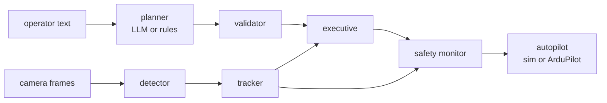

# Kestrel: a language-tasked aerial observer

[](https://github.com/mustafarkhan/kestrel/actions/workflows/ci.yml)
[](LICENSE)


Tell a small drone, in plain English, to *"survey the north field at 25 m and if you see a drone, follow it from
30 m for 60 seconds, then come home"*. Kestrel turns that into a validated flight plan, flies it, finds the other
aircraft **in camera pixels**, tracks it, holds a safe standoff while observing it, resumes the survey and lands. A
language model writes the plan; it never touches the controls. Every setpoint passes an independent safety monitor
that no planner, learned or not, can get past.


| | how | measured |
|---|---|---|
| **Plan from language** | local LLM (Ollama) constrained to a JSON Schema, re-validated, one repair round, deterministic fallback; stop/abort/land bypass the model | malformed, invented-site and garbage outputs all rejected in tests; same plan with or without a model |
| **Check before flight** | geofence, altitude band, speed, standoff vs. separation, battery energy | estimate vs. flown energy: 0.92 (median, benchmark) |
| **See other aircraft** | small-target sky detector on rendered frames: black top-hat, robust threshold, horizon mask, darker-than-sky test | ~80% of frames detected out to 60 m on 2-7 px targets; 0 false alarms in 160 random cloudy-sky frames |
| **Track them** | bearing + log-range EKF per track, global-nearest-neighbour association, M-of-N confirmation | 4.4 m median / 5.0 m p90 position error at ~30 m range |
| **Observe safely** | standoff guidance from below (target against sky), parallax orbit, stabilised gimbal, contact watch, escape velocity | intruder in view 100% of shadowing time; median-run closest approach 13.4 m (limit 12 m); see [Results](#results) for the runs that went inside it |
| **Fly a real autopilot** | ArduPilot GUIDED over MAVLink (pymavlink) | full mission flown on **ArduCopter 4.6.3 SITL in CI** |

> **Status (October 2026, v0.1).** Everything here runs in simulation and on ArduCopter SITL. It has **not flown on
> a real airframe**, the camera and aircraft models are simplified, and nothing is flight-qualified. The known gaps
> are listed under [Limitations](#limitations) and in [docs/safety.md](docs/safety.md).

## Quick start

```bash
git clone https://github.com/mustafarkhan/kestrel && cd kestrel
pip install -e ".[dev]"

# parse + validate only (instant)
kestrel plan "take off, orbit the tower twice at 20 m with a radius of 30 m, then search the lake for 2 minutes, then come back"

# closed-loop simulation with report plots and the demo animation (about 2.5 min on a 2-core machine)
kestrel sim "Take off to 25 m, survey the north field at 25 m with 30 m spacing, and if you see a drone, \
follow it from 30 m for 60 seconds, then return home" --gif --out runs/demo

# operator emergencies are injected by time: abort at t = 60 s
kestrel sim "survey the north field at 25 m" --command "60:abort"
```

With a local language model (optional; without one the rule parser handles constrained English):

```bash
ollama pull qwen2.5:3b
kestrel plan "go have a look over the north field and keep an eye on any drone you spot" --llm
```

Against ArduCopter SITL (or a real ArduPilot vehicle):

```bash
# in an ArduPilot checkout: build/sitl/bin/arducopter --model quad --defaults Tools/autotest/default_params/copter.parm -I0
kestrel fly "take off to 15 m, fly to the tower, orbit the tower with a radius of 15 m, then return home" \
  --connect tcp:127.0.0.1:5760
```

What the planner hands the rest of the stack:

```text
$ kestrel plan "survey the lake at 20 m with 6 m spacing then hover for 25 minutes"
planner: rules
plan: takeoff(altitude=20.0) -> survey(area=lake, altitude=20.0, spacing=6.0) -> hold(duration_s=1500.0) -> return_home()  [on_contact=report]
estimate: 27.6 min, 97.9 Wh of 61.6 Wh usable
warning: added takeoff at the start
warning: added return_home at the end
ERROR: estimated energy 98 Wh exceeds the 62 Wh usable (20% reserve held back)
result: REJECTED
```

## Results

A Monte Carlo benchmark flies the same mission (survey, shadow any contact for 45 s, return) against
24 randomised encounters: intruder pattern (figure-eight, orbit, random waypoints), speed 2-6 m/s, altitude
26-40 m, position, appearance time, wind 0-5 m/s with gusts, and a different sky each run.

| metric | result |
|---|---|
| missions completed and landed (all within 1.5 m of home) | 24/24 |
| runs where a contact was detected and shadowed | 23/24 |
| runs with any time inside the 12 m minimum separation | 8/24, each for at most 3.9 s |
| closest approach over all runs (median run) | 8.2 m (13.4 m) |
| track position error while shadowing, median of runs (p90 of runs) | 4.4 m (5.0 m) |
| intruder inside the camera frame while shadowing (median run) | 100% |
| false tracks per run (median) | 3 |
| flown energy / pre-flight estimate (median) | 0.92 |

**About the 8 runs that went inside 12 m.** The closest approaches were 8.2, 9.5, 9.5, 10.0, 10.7, 11.1, 11.4 and
11.8 m, none longer than 3.9 s and none a collision. In seven, the intruder was being tracked; six of those involved
intruders at 4.1-5.4 m/s, the fast end of the tested range, where an intruder turning towards the observer closes
faster than the observer can open the gap. In the eighth, the intruder passed beside the observer outside the camera's view and was never detected.
Diagnosing an earlier run of this benchmark (9 runs, worst 5.1 m) produced the escape-velocity and retreat-on-loss
behaviours ([0004](docs/decisions/0004-separation.md)). The remaining gap is the next thing to work on, not something
to tune away.

Reproduce with `kestrel bench --runs 24`; per-run rows are in
[docs/results/bench_results.csv](docs/results/bench_results.csv). A test fails CI if this table and
[the committed summary](docs/results/bench_summary.json) disagree.


## How it works



Three independent barriers stand between language and motors: the **schema** (the model can only express known
tasks), **static validation** (the plan must fit the fence, altitude band, battery and separation rules before
takeoff) and a **runtime monitor** (every setpoint, every tick). Details in [docs/architecture.md](docs/architecture.md)
and [docs/safety.md](docs/safety.md).

The separation buffer around another aircraft is the part that most needed simulation to get right. It is the minimum
separation plus the larger of the track uncertainty (floored at 15% of range, because monocular range rests on an
assumed target size) and a reachable set that grows while the aircraft is unseen, plus stopping distance at the current
closing speed. Each term exists because an encounter broke the limit without it:
[docs/decisions/0004-separation.md](docs/decisions/0004-separation.md).

## Engineering notes

Problems found in simulation and fixed, with before/after measurements, are written up as decision records:

| | problem | fix |
|---|---|---|
| [0001](docs/decisions/0001-llm-plans-never-pilots.md) | language control is slow, non-deterministic, sometimes wrong | the model writes a schema-checked plan only |
| [0002](docs/decisions/0002-darker-than-sky.md) | gaps between clouds keep a constant bearing and were tracked as an aircraft pacing the observer | darker-than-clear-sky test: 98.6% of clutter rejected |
| [0003](docs/decisions/0003-stabilised-gimbal.md) | rigid camera pointed at the ground whenever the airframe tilted | stabilised gimbal with commanded tilt |
| [0004](docs/decisions/0004-separation.md) | four distinct separation violations (5.0 m to 1.8 m) | range floor, stopping distance, reachable set, contact watch |
| [0005](docs/decisions/0005-attitude-limit-cycle.md) | 180° heading reversal triggered a roll/pitch limit cycle and a fall | yaw slew limit, attitude-priority mixer: 47.6° → 3.6° tilt |
| [0006](docs/decisions/0006-cascaded-position-loop.md) | 13.8 m/s against an 8 m/s limit | cascaded, speed-saturated position loop |
| [0007](docs/decisions/0007-speed-planning.md) | 15 m orbit took 90 s on SITL | curvature-aware speed profile: 22 s |
| [0008](docs/decisions/0008-mavlink-adapter.md) | SITL armed and disarmed in a loop | heartbeat-derived ids, single reader, origin on the ground |

## Testing

| job | what | runs |
|---|---|---|
| `lint` | ruff, ruff format, mypy `--strict` | every push |
| `unit` | 63 tests incl. property-based safety invariants (Hypothesis), rendered-frame perception checks, LLM planner against a local HTTP server | Python 3.11, 3.12, 3.13 |
| `closed-loop` | full-stack simulations: detect, track and keep separation; operator abort; link-loss failsafe; rejected plans never fly | every push |
| `sitl` | builds ArduCopter 4.6.3 SITL (cached) and flies a mission through GUIDED mode | every push |

```bash
pytest -m "not slow and not sitl"   # ~20 s
pytest -m slow                      # a few minutes
ARDUPILOT_SITL=.../arducopter ARDUPILOT_DEFAULTS=.../copter.parm pytest -m sitl
```

## Limitations

- **One forward camera.** An aircraft that never enters the field of view cannot be avoided. After first contact the
  observer keeps its camera on the intruder's last known position while nearby, but an unknown aircraft arriving from
  behind is not seen. A rear camera, radar, or a Remote ID / ADS-B feed would close this.
- **Dark targets against sky.** Sunlit targets brighter than the sky and targets below the horizon are out of scope
  for the detector. A learned detector can replace it behind the same `Detection` interface.
- **Monocular range** rests on an assumed target size (0.35 m). A much smaller aircraft reads as farther away than it
  is; the safety monitor's 15% range-uncertainty floor covers modest errors, not a wrong aircraft class.
- **ArduPilot only.** PX4 OFFBOARD is detected and refused rather than half-supported.
- **Simplified models**: linear drag, first-order motors, a synthetic sky, kinematic intruders.

## Repository layout

```text
src/kestrel/
  mission/      schema, rule parser, LLM planner, validator, task geometry, executive
  perception/   camera + gimbal, sky renderer, detector, tracker
  guidance/     paths, speed planning, reference filter, standoff observation
  safety/       runtime monitor, energy model
  control/      cascaded position + SE(3) attitude control, mixer
  sim/          rigid-body quadrotor, wind, intruders, world
  vehicle/      Vehicle protocol, simulated vehicle, ArduPilot over MAVLink
  runtime.py    closed-loop simulation      live.py   real-time loop for MAVLink
  bench.py      Monte Carlo benchmark       cli.py    kestrel plan | sim | bench | fly
docs/           architecture, safety case, decision records, published results
scenarios/      world definitions (fence, sites, wind, intruders)
tests/          unit, property, closed-loop and SITL tests
```

## License

Apache-2.0. See [LICENSE](LICENSE). If you use this work, see [CITATION.cff](CITATION.cff).
