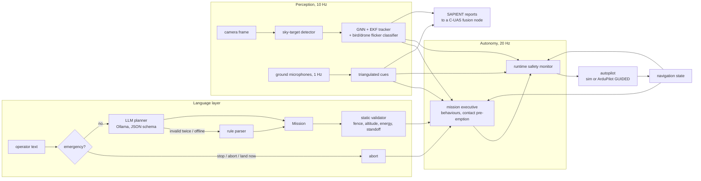

# Architecture

Kestrel is an autonomy stack for a small multirotor that is *told* what to do in
plain language and *sees* other aircraft with a single camera. Everything runs in
one Python process at a fixed rate; the autopilot (simulated, or ArduPilot over
MAVLink) only ever receives position / velocity / acceleration setpoints.

## Layers

| Module | Responsibility | Key idea |
|---|---|---|
| `mission/parser.py` | emergency phrases; rule-based parsing | stop/abort/land never wait for a model |
| `mission/llm.py` | language → `Mission` via local LLM | schema-constrained output, re-validated, one repair round, deterministic fallback |
| `mission/validator.py` | pre-flight checks | rejects with reasons; only structural normalisation |
| `mission/geometry.py` | task → concrete path | the plan that is checked is the plan that is flown |
| `mission/executive.py` | behaviours, pre-emption, resume, aborts | contacts interrupt and the interrupted task resumes from where it was |
| `guidance/trajectory.py` | paths, speed planning, reference filter | curvature-aware speed profile; consistent pos/vel/acc |
| `guidance/observer.py` | standoff observation of a target | look up against sky; orbit for parallax |
| `perception/render.py` | synthetic camera frames | detector runs on pixels, so false alarms are emergent |
| `perception/detector.py` | small dark targets against sky | black top-hat, robust threshold, horizon mask, darker-than-sky test |
| `perception/tracker.py` | multi-target tracking | bearing + log-range EKF, GNN association, M-of-N confirmation |
| `perception/classify.py` | bird or drone | wing-beat flicker in the track's brightness, against sensor noise |
| `perception/acoustic.py` | ground microphone network | bearings triangulated into horizontal fixes; altitude unknown, so a column |
| `interop/sapient.py` | reports to other systems | SAPIENT ICD v7 registration, status, detection; UTM coordinates |
| `sim/birds.py` | birds in the simulated sky | intermittent flapping and gliding, wandering paths |
| `safety/monitor.py` | run-time assurance | every setpoint filtered; latched RTL/LAND |
| `safety/energy.py` | battery planning model | shared by validator and monitor |
| `control/` | cascaded position/velocity + SE(3) attitude, mixer | what the simulated autopilot runs |
| `vehicle/` | `Vehicle` protocol: simulator or ArduPilot | identical autonomy code for both |

## Frames and clocks

* World frame ENU, metres, origin at home; body FLU. MAVLink NED/FRD is converted
  only in `vehicle/mavlink_vehicle.py`.
* The simulator steps physics at 400 Hz, autonomy at 20 Hz, the camera at 10 Hz.
  Detections are delivered after the configured latency and fused at capture time.
* Frames are rendered from the *true* pose but processed with the *estimated*
  pose, so navigation error turns into bearing error exactly as on an aircraft.
* With a real autopilot, the mission clock is the autopilot's boot time, so the
  loop also behaves correctly under SITL `--speedup`.

## Data contracts

* **`Mission`** (pydantic): the only thing the language layer can produce. Its
  JSON Schema is what the LLM is constrained to.
* **`Setpoint`**: position, velocity and acceleration feed-forward plus yaw; maps
  1:1 onto `SET_POSITION_TARGET_LOCAL_NED`.
* **`VehicleState`**: the navigation solution (an estimate, never truth).
* **`Detection` / `TrackEstimate`**: pixel detections in, world-frame tracks with
  covariance out, plus the probability the track is a drone rather than a bird. A
  learned detector can replace the classical one behind the same `Detection` type.
* **SAPIENT messages**: what leaves the system for a counter-UAS fusion node
  ([interop.md](interop.md)).
